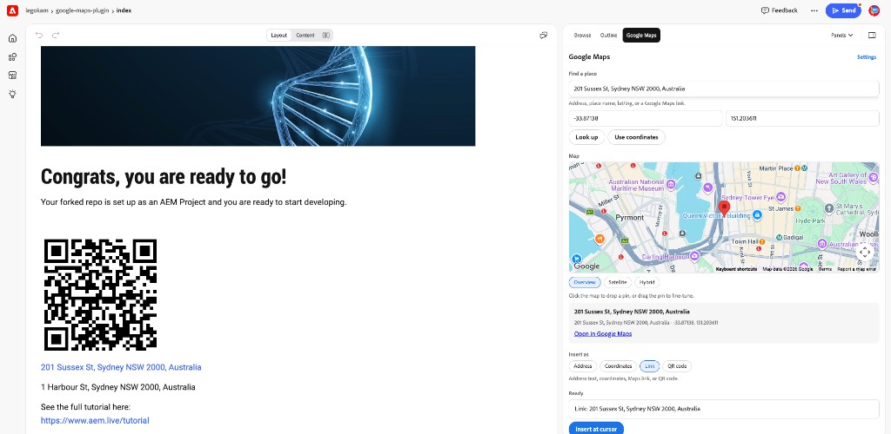
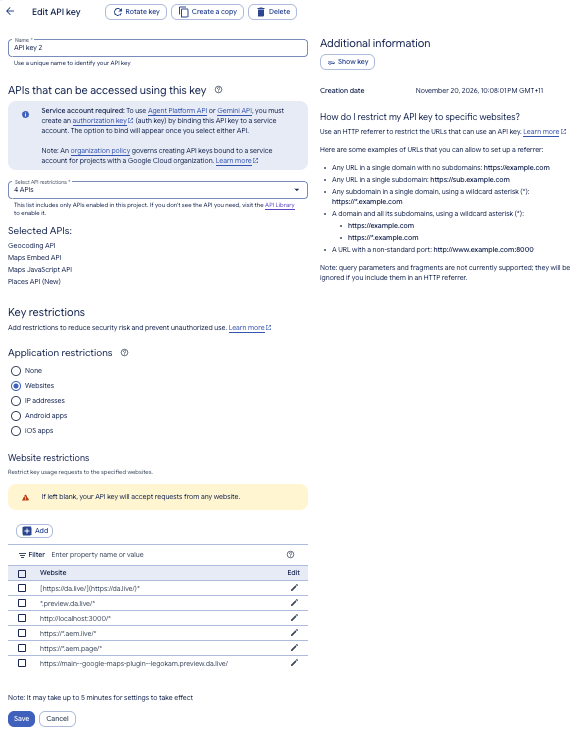
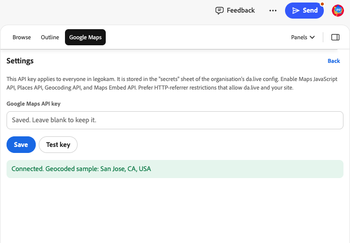
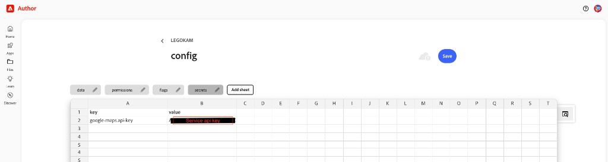

# Google Maps — Experience Workspace plugin

An Edge Delivery Services / Experience Workspace plugin that lets authors find a place and insert it into the document as an address, coordinates, Google Maps link, or QR code.

Plugin files live in [`tools/google-maps/`](tools/google-maps/).



## Environments

- Preview: https://main--google-maps-plugin--LegoKam.aem.page/
- Live: https://main--google-maps-plugin--LegoKam.aem.live/

Replace `LegoKam` / `google-maps-plugin` with your org and site names if this repo was forked.

## What you get

- **Interactive map** — drop or drag a pin; switch **Overview**, **Satellite**, and **Hybrid** layers
- **Find a place** — search with Places Autocomplete, enter latitude/longitude, or paste a Google Maps URL
- **Insert as**
  - **Address** — formatted address text
  - **Coordinates** — `lat, lng`
  - **Link** — linked place name opening Google Maps
  - **QR code** — QR image pointing at the Maps URL, plus the link
- **Org-wide settings** — Google Maps API key stored in the organisation’s da.live `secrets` sheet

Without an API key you can still paste a Maps URL or type coordinates and insert address / link / QR. The interactive map, autocomplete, and geocoding need a key.

## Install

### 1. Clone and run locally

```sh
git clone https://github.com/LegoKam/google-maps-plugin.git
cd google-maps-plugin
npm i
npx -y @adobe/aem-cli up
```

The site is at `http://localhost:3000`. The plugin page is:

`http://localhost:3000/tools/google-maps/google-maps.html`

### 2. Register the plugin in da.live

1. Open the site config: [da.live/config#/legokam/google-maps-plugin/](https://da.live/config#/legokam/google-maps-plugin/)
2. Open the **library** sheet (create it if it does not exist).
3. Add a row:

   | title       | path                                      | ref   |
   | ----------- | ----------------------------------------- | ----- |
   | Google Maps | `/tools/google-maps/google-maps.html`     |       |

   For **local development** before the code is on `main`, use:

   | title       | path                                                        | ref   |
   | ----------- | ----------------------------------------------------------- | ----- |
   | Google Maps | `http://localhost:3000/tools/google-maps/google-maps.html`  | local |

4. Save the config.

### 3. Open Experience Workspace

- Local plugin: [da.live/canvas?ref=local#/legokam/google-maps-plugin/index](https://da.live/canvas?ref=local#/legokam/google-maps-plugin/index)
- Shipped plugin (after merge to `main`): [da.live/canvas#/legokam/google-maps-plugin/index](https://da.live/canvas#/legokam/google-maps-plugin/index)

Open **Panels → Extensions → Google Maps**.

`ref=local` only loads rows whose library `ref` is `local` (or any row when the page ref is `local`). Clear the library `ref` and drop `?ref=local` once the plugin is served from `main`.

## Configure Google Maps

### 1. Google Cloud API key

1. In [Google Cloud Console](https://console.cloud.google.com/) create (or reuse) a project with billing enabled.
2. Enable **Maps JavaScript API**, **Places API (New)**, and **Geocoding API**.
3. Create an API key (APIs & Services → Credentials → Create credentials → API key), then open **Edit API key**.
4. Under **API restrictions**, choose **Restrict key** and select at least:
   - Geocoding API
   - Maps JavaScript API
   - Places API (New)
5. Under **Application restrictions**, choose **Websites** and add HTTP referrers such as:

   | Website restriction |
   | ------------------- |
   | `https://da.live/*` |
   | `*.preview.da.live/*` |
   | `http://localhost:3000/*` |
   | `https://*.aem.live/*` |
   | `https://*.aem.page/*` |

   Add your site’s preview host if needed (for example `https://main--google-maps-plugin--legokam.preview.da.live/`). Changes can take up to a few minutes.



### 2. Save the key for the organisation

In the plugin, open **Settings**, paste the key, **Test key**, then **Save**.



Settings are written to the organisation config’s **secrets** sheet as:

| key                   | example       |
| --------------------- | ------------- |
| `google-maps.api-key` | *(your key)*  |

You can also edit that sheet directly at [da.live/config#/legokam/](https://da.live/config#/legokam/) (org config, **secrets** tab). Header row must be `key` / `value`.



**Security note:** anyone who can read the org config can read the API key. Keep **Websites** referrer restrictions on the key as shown above.

If the config editor tab was already open when you saved from the plugin, reload it before pressing Save there — a stale empty sheet can overwrite the plugin’s rows.

## Use

1. Open the Google Maps panel in Experience Workspace.
2. Find a place: search (pick a suggestion), enter coordinates, paste a Maps URL, or **click the map to drop a pin** (drag to adjust). Use **Overview** / **Satellite** / **Hybrid** for map layers.
3. Choose **Insert as**: Address, Coordinates, Link, or QR code.
4. **Insert at cursor**, or **Replace selection** / **Insert after selection** when text is selected.

## Develop

```sh
npx -y @adobe/aem-cli up   # http://localhost:3000
npm run lint
```

| File | Role |
| ---- | ---- |
| `tools/google-maps/google-maps.html` | Plugin shell |
| `tools/google-maps/google-maps.js` | UI and SDK wiring |
| `tools/google-maps/google-maps.css` | Styles |
| `tools/google-maps/map-ui.js` | Interactive map, pin, layer controls |
| `tools/google-maps/location.js` | Place resolution, URLs, insert HTML |
| `tools/google-maps/secrets.js` | Read/write org `secrets` sheet |

Useful SDK actions: `getSelection`, `sendHTML`. See [Developing apps & plugins](https://docs.da.live/developers/guides/developing-apps-and-plugins).

## Edge Delivery docs

1. [Developer Tutorial](https://www.aem.live/developer/tutorial)
2. [The Anatomy of a Project](https://www.aem.live/developer/anatomy-of-a-project)
3. [Markup, Sections, Blocks, and Auto Blocking](https://www.aem.live/developer/markup-sections-blocks)
